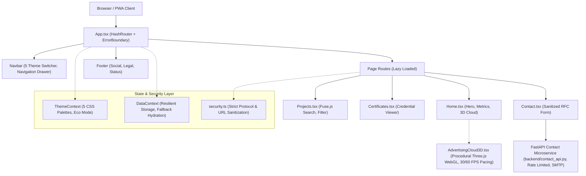

# Akash Kundu — AI Systems & Full-Stack Portfolio

[](https://akashkundu.me)
[](https://react.dev/)
[](https://vitejs.dev/)
[](https://www.typescriptlang.org/)
[](https://vitest.dev/)
[](https://fastapi.tiangolo.com/)
[](LICENSE)

A high-performance, accessible, and responsive personal portfolio showcasing production AI architectures, local multi-agent systems, biomedical computer vision models, unsupervised machine learning research, and full-stack web applications.

Deployed on **GitHub Pages** with a custom domain at [akashkundu.me](https://akashkundu.me) (fallback: [AkashKundu114.github.io](https://akashkundu114.github.io)).

---

## 🌟 Featured Engineering Projects

| Project                                                                                        | Domain                            | Architecture & Technologies                                                                                                             | Validated Metrics                                                                                                                                                                    |
| ---------------------------------------------------------------------------------------------- | --------------------------------- | --------------------------------------------------------------------------------------------------------------------------------------- | ------------------------------------------------------------------------------------------------------------------------------------------------------------------------------------ |
| **[C.O.P.P.E.R.](https://github.com/AkashKundu114/COPPER)**                                    | Local AI OS / Multi-Agent Systems | 14B Sovereign Core LLMs, TFP Cascade Router, DFM-Guard Safety Protocol, Electron + React 19, SQLite WAL, ChromaDB                       | **~9,856 QPS** dispatch (<0.10ms latency); **100% Threat Catch** (350 adversarial triggers); **685 tests** passing (644 Pytest + 41 Vitest); Zero cloud egress on 8 GB VRAM.         |
| **[OphthalmoAI](https://github.com/AkashKundu114/OphthalmoAI)**                                | Medical AI / Retinal Screening    | Tri-Backbone Soft Ensemble (DenseNet-201, ConvNeXt, EfficientNet-V2), Platt Scaling, OAC-DG Domain Guardrail, ONNX Runtime Web WASM     | **85.18% Test Accuracy**; **0.9818 Macro AUROC**; **0.0381 ECE** calibration; **97.84% rejection** on non-fundus stress scans; **335 tests** passing (312 Pytest + 23 Vitest).       |
| **[Inductive Consensus Clustering (ICC-v2)](https://github.com/AkashKundu114/icc-clustering)** | Machine Learning Research         | VSSG Subspace Gating (Bimodality Coefficient), $O(NL)$ Bipartite Anchor Consensus Graph, Closed-Form Inductive Out-of-Sample Projection | **Rank #1** on cancer microarrays (Leukemia ARI 0.680); **-74.2% Peak RAM** reduction on $D=5,000$; Linear scaling to $N=1,000,000$; **113 Pytest tests** passing; IEEE manuscripts. |
| **[AI-SATHI](https://github.com/AkashKundu114/AI-SATHI)**                                      | Voice AI / Social Innovation      | Sarvam AI Bengali ASR/TTS, Ollama Fallback Cascade, LangGraph State-Machines, PostgreSQL pgvector RAG, Azure Container Apps             | **0% Hallucination** on micro-finance scheme matching; 2,000 msgs/day pilot throughput; **389 tests** passing; Field-tested across 8 SHGs in West Bengal.                            |
| **[Portfolio CMS](https://github.com/AkashKundu114/AkashKundu114.github.io)**                  | Headless CMS & PWA                | React 18, Vite PWA (Workbox), HashRouter, DataContext Storage Layer, Fuse.js Search, Three.js WebGL                                     | **129 Vitest tests** passing (100%); 1.07 MB precache; 30/60 FPS WebGL frame pacing; WCAG 2.2 AA compliant across 5 themes.                                                          |

---

## 🏛️ System Architecture



---

## 📁 Repository Directory Map

```
AkashKundu114.github.io/
├── .github/
│   └── workflows/
│       └── deploy.yml           # CI/CD: runs lint, typecheck, tests, and builds before deploying to GitHub Pages
├── backend/
│   ├── contact_api.py           # Production FastAPI contact microservice with rate limiting & RFC SMTP guards
│   ├── requirements.txt         # Pinned Python microservice dependencies
│   └── .env.example             # Backend SMTP environment configuration template
├── docs/                        # Exhaustive audit reports, benchmarks, and matrices
│   ├── README.md                # Documentation index
│   ├── PROJECT_SYNCHRONIZATION_MATRIX.md
│   ├── PORTFOLIO_AUDIT_REPORT.md
│   ├── PORTFOLIO_SECURITY_RELEASE_REPORT.md
│   ├── PORTFOLIO_WEB_RED_TEAM_REPORT.md
│   ├── PORTFOLIO_PRIVACY_REPORT.md
│   ├── PORTFOLIO_RESOURCE_EFFICIENCY_REPORT.md
│   ├── PORTFOLIO_PERFORMANCE_BENCHMARKS.md
│   ├── PORTFOLIO_RESPONSIVENESS_REPORT.md
│   ├── PORTFOLIO_ACCESSIBILITY_PERFORMANCE_REPORT.md
│   ├── PORTFOLIO_DEPENDENCY_AUDIT.md
│   ├── PORTFOLIO_TEST_RESULTS.md
│   ├── PORTFOLIO_RELEASE_TEST_RESULTS.md
│   ├── PORTFOLIO_UI_UX_MATRIX.md
│   ├── PORTFOLIO_CHANGELOG.md
│   └── PORTFOLIO_SECURITY_CHANGELOG.md
├── public/                      # Static assets served as-is
│   ├── certificates/            # Verified certificate PDFs and PNG previews (13 pairs)
│   ├── cv/                      # AkashKundu_CV.pdf and LaTeX resumes
│   ├── icons/                   # Favicon, PWA icons (192, 512), and Open Graph preview
│   ├── projects/                # Architecture diagrams (SVG vectors)
│   ├── CNAME                    # Domain configuration (akashkundu.me)
│   ├── manifest.json            # PWA manifest
│   ├── robots.txt               # Search crawler permissions
│   └── sitemap.xml              # Search engine index
├── src/
│   ├── __tests__/               # Automated Vitest test suites (13 files, 129 tests)
│   ├── components/              # Modular UI components
│   │   ├── AdvertisingCloud3D.tsx # Lazy-loaded Three.js procedural WebGL simulation
│   │   ├── AmbientBackground.tsx  # Dynamic geometric backdrop
│   │   ├── CustomCursor.tsx       # Smooth tracking cursor with boundary protection
│   │   ├── ErrorBoundary.tsx      # Defensive fallback boundary for runtime error containment
│   │   ├── EvilButtons.tsx        # Tactile, Glass, Shiny, and 3D button primitives
│   │   ├── Footer.tsx             # Semantic footer with legal and social links
│   │   ├── LiquidGlassLens.tsx    # Adaptive backdrop lens blur
│   │   ├── Navbar.tsx             # Responsive header with theme selector and mobile drawer
│   │   └── PageTransition.tsx     # Route transition wrapper
│   ├── context/
│   │   ├── DataContext.tsx        # Content store with localStorage persistence & CRUD boundaries
│   │   └── ThemeContext.tsx       # 5 CSS-variable theme palettes with Eco Mode
│   ├── data/
│   │   ├── certificates.ts        # Typed credentials, credentials IDs, and verification URLs
│   │   ├── education.ts           # Academic credentials, institutions, and CGPA
│   │   ├── projects.ts            # Project case studies, architectures, metrics, and screenshots
│   │   └── skills.ts              # Categorized skills matrix (Languages, AI/ML, Backend, UI, Cloud)
│   ├── hooks/
│   │   ├── useDocumentTitle.ts    # Dynamic document title management
│   │   └── useScrollReveal.ts     # Boundary-checked IntersectionObserver scroll triggers
│   ├── pages/                     # 13 lazy-loaded route components
│   │   ├── Home.tsx, About.tsx, Skills.tsx, Projects.tsx, ProjectDetail.tsx,
│   │   ├── Certificates.tsx, CertificateDetail.tsx, Education.tsx, Contact.tsx,
│   │   └── Admin.tsx, Terms.tsx, Privacy.tsx, NotFound.tsx
│   ├── utils/
│   │   └── security.ts            # Protocol whitelist, open redirect guard, and Web Crypto SHA-256
│   ├── App.tsx                    # Root component with routing, skip-link, and Suspense
│   ├── index.css                  # Theme tokens, base styles, and utility classes
│   └── main.tsx                   # React 18 DOM bootstrap
├── .editorconfig                # Universal indentation and line-ending rules
├── .env.example                 # Root environment variable documentation
├── .gitattributes               # Line-ending normalization (LF text, binary assets)
├── .gitignore                    # Comprehensive repository ignore rules
├── .hintrc                      # Webhint configuration
├── CONTRIBUTING.md              # Contribution guidelines, branch workflows, and PR checklist
├── index.html                   # HTML5 entry with strict CSP, schema.org JSON-LD, and meta tags
├── LICENSE                      # MIT License
├── package.json                 # Project configuration and npm scripts
├── prettier.config.js           # Code formatting configuration
├── SECURITY.md                  # Security policy and responsible vulnerability reporting
├── tsconfig.json                # TypeScript compiler configuration
├── vite.config.js               # Vite build, PWA Workbox precaching, and manual chunk splitting
└── vitest.config.ts             # Vitest test runner configuration
```

---

## 🚀 Quickstart & Local Development

### Prerequisites

- **Node.js**: `20.x` or later (LTS recommended)
- **npm**: `10.x` or later
- **Python**: `3.10+` (optional, for running the local contact API microservice)

### 1. Clone the Repository

```bash
git clone https://github.com/AkashKundu114/AkashKundu114.github.io.git
cd AkashKundu114.github.io
```

### 2. Install Frontend Dependencies

```bash
npm install
```

### 3. Configure Environment Variables

```bash
cp .env.example .env
```

_(Default values work out of the box for local development)._

### 4. Start the Frontend Development Server

```bash
npm run dev
```

Open `http://localhost:5173/` in your browser.

---

## 🧪 Testing & Quality Gates

The repository enforces strict verification standards. All commands can be run locally:

```bash
# Run all 129 automated unit and integration tests
npm test

# Verify TypeScript type correctness without emitting code
npm run typecheck

# Check code against ESLint rules
npm run lint

# Check code formatting with Prettier
npm run format:check

# Auto-format all files
npm run format

# Compile production bundle
npm run build

# Preview production build locally
npm run preview
```

---

## 🔌 Running the Contact API Microservice (Optional)

The contact form in `src/pages/Contact.tsx` submits to a FastAPI backend microservice located in `backend/`:

```bash
cd backend

# Create virtual environment
python -m venv venv
# On Windows:
venv\Scripts\activate
# On Linux/macOS:
source venv/bin/activate

# Install dependencies
pip install -r requirements.txt

# Configure SMTP credentials
cp .env.example .env
# Edit .env with your SMTP credentials

# Run FastAPI server
uvicorn contact_api:app --reload --port 8000
```

---

## 🔒 Security & Privacy Engineering

- **Strict Content-Security-Policy (CSP):** Configured in `index.html` preventing unauthorized script execution, malicious form actions, or protocol-relative injection.
- **Defensive URL Sanitization:** All internal and external links are validated using `sanitizeUrl()` and `sanitizeRedirectPath()`, mitigating open redirect and XSS attack vectors.
- **Zero Inlined Credentials:** No plaintext passwords or private keys are stored in client-side bundles. The administrative view uses client-side SHA-256 Web Crypto hashing for demonstration management.
- **Zero Third-Party Trackers:** No analytics beacons, Google Tag Manager, or tracking pixels. LocalStorage is strictly sandboxed.
- **Resource Efficiency:** Three.js WebGL simulation incorporates 30/60 FPS dynamic frame pacing, an automatic 25-second idle pause, and an Eco Mode toggle to minimize GPU/CPU utilization.

For detailed security policies or vulnerability reporting, see [SECURITY.md](SECURITY.md).

---

## 📜 License

This project is open source and available under the terms of the [MIT License](LICENSE).

Copyright &copy; 2026 **Akash Kundu**. All rights reserved.
